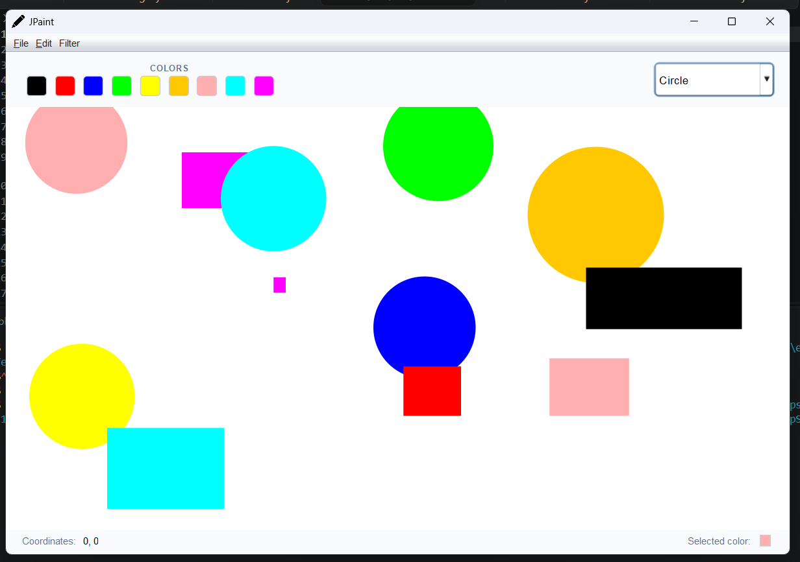

# JPaint 🎨

A desktop drawing application built with **Java Swing**, featuring interactive shape drawing, color selection, drawing management, and SQLite database persistence.

Developed as part of a university Java course and further refined to improve the user interface and functionality.



## Features

- **Shape Drawing** – Draw rectangles and circles using mouse interactions.
- **Color Selection** – Choose drawing colors from a color palette.
- **Undo & Redo** – Undo and redo drawing actions using keyboard shortcuts.
- **Shape Filtering** – Display all shapes or filter by rectangles and circles.
- **Drawing Management** – Create new drawings and manage their names and authors.
- **Database Persistence** – Save and load drawings using SQLite.
- **PNG Export** – Export drawings as PNG images.
- **Drawing Statistics** – View the number of shapes, total area, and total circumference.
- **Status Bar** – Display mouse coordinates and the currently selected color.

## Technologies

- **Java 17**
- **Java Swing & AWT** – Desktop user interface and graphics
- **SQLite** – Local database storage
- **JDBC** – Database connectivity
- **Apache Maven** – Dependency management and build configuration

## Getting Started

### Requirements

- Java Development Kit (JDK) 17 or later
- Apache Maven

### Installation

Clone the repository:

```bash
git clone https://github.com/EmmaSjoberg/JPaint.git
```

Run the application:

```bash
mvn compile exec:java
```

Maven automatically downloads the required dependencies.

A local SQLite database (`jpaint.db`) is created when drawings are saved.

## How to Use

1. Select a shape (rectangle or circle) and a drawing color.
2. Click and drag on the canvas to create shapes.
3. Use **Ctrl+Z** and **Ctrl+Y** to undo or redo drawing actions.
4. Create a new drawing using **File → New** or **Ctrl+N**.
5. Assign a name and author to save the drawing.
6. Use **File → Save to Database** or **Load from Database** to manage saved drawings.
7. Export your drawing using **File → Export as PNG**.

## Project Structure

```text
JPaint/
├── img/                  # Application screenshots and images
│   ├── JPaint.png
│   └── pen.png
├── lib/                  # Local libraries
├── src/
│   └── se/miun/emsj2403/dt187g/jpaint/
│       ├── geometry/     # Shape models and geometry
│       ├── gui/          # Swing interface components
│       ├── AppStart.java
│       ├── Drawing.java
│       ├── Drawable.java
│       ├── DrawingException.java
│       └── FileHandler.java
├── pom.xml
└── README.md
```

## Technical Overview

The application follows an object-oriented design, separating geometry, drawing management, user interface components, and data persistence.

- **Geometry models** represent shapes and their properties.
- **Drawing** manages shapes and calculates drawing statistics.
- **Swing components** handle user interactions, rendering, and application controls.
- **FileHandler** manages SQLite database operations for saving and loading drawings.

## Background

JPaint was originally developed as part of a Java programming course at **Mid Sweden University**.

The project was subsequently refined to improve usability, visual design, and functionality while maintaining its original object-oriented structure.
